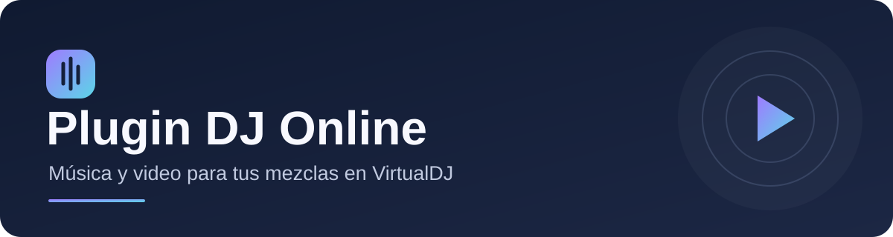

  

  **Busca música y video, y cárgalos directamente en VirtualDJ.**

  
  
  

## 🎵 ¿Qué puedes hacer?

- **Buscar música y videos** desde el navegador de VirtualDJ.
- **Cargar una pista en un deck** con su audio y video.
- **Reutilizar archivos descargados** para cargar más rápido una canción que ya habías usado.
- **Consultar el estado de las actualizaciones** desde el icono del programa en el área de notificaciones de Windows.

## ✨ Comienza a usarlo

**Necesitas:** Windows 10 u 11 de 64 bits, VirtualDJ Pro y conexión a internet.

1. Descarga el instalador desde [la versión más reciente](https://github.com/IviOlivos18/plugin-dj-yt-online/releases/latest).
2. Cierra VirtualDJ, abre el instalador y haz clic en **Instalar**.
3. Cuando termine, abre VirtualDJ y busca **YouTube Plugin Online** en la sección **Online Music**.
4. Escribe el nombre de una canción o video y carga el resultado en un deck.

La primera instalación puede tardar varios minutos mientras se preparan los componentes necesarios. La primera vez que cargas un video, el programa descarga el audio y la imagen antes de abrirlo en VirtualDJ.

## 💾 Archivos descargados

Los videos utilizados se guardan en la caché del programa para que puedas volver a cargarlos. Por ahora, **no se eliminan automáticamente**, así que ocupan espacio en tu computadora.

## 💜 Créditos y licencia

Este proyecto es una adaptación de [VDJ Companion](https://github.com/rcsy-px/vdj-stream), creado por **rcsy-px**. Conserva su aviso de copyright y su [licencia MIT](LICENSE). Consulta los [avisos de terceros](THIRD_PARTY_NOTICES.md) para conocer las demás dependencias.

Plugin DJ Online es un proyecto independiente y no está afiliado a YouTube ni a VirtualDJ. El uso del contenido está sujeto a los derechos correspondientes y a las condiciones de los servicios utilizados.
